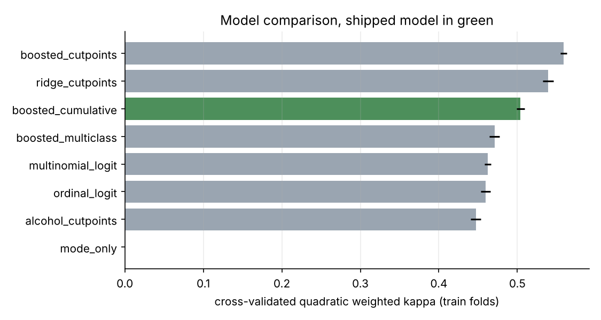
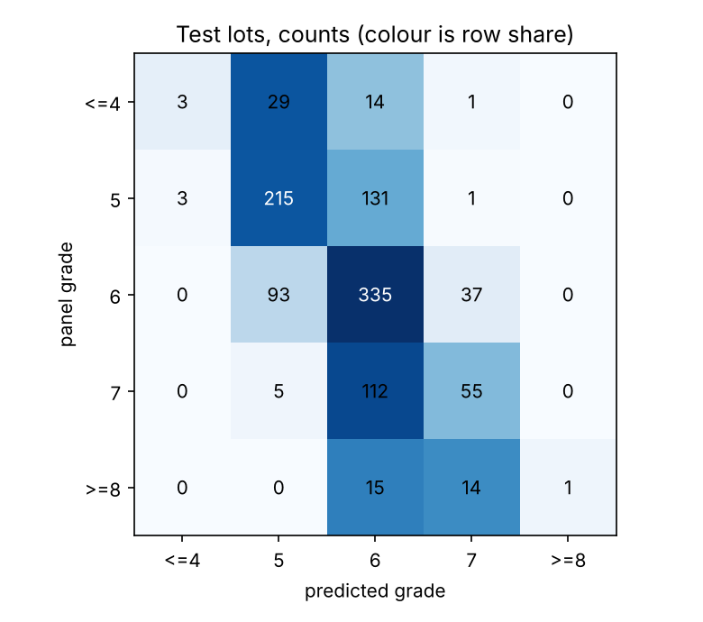
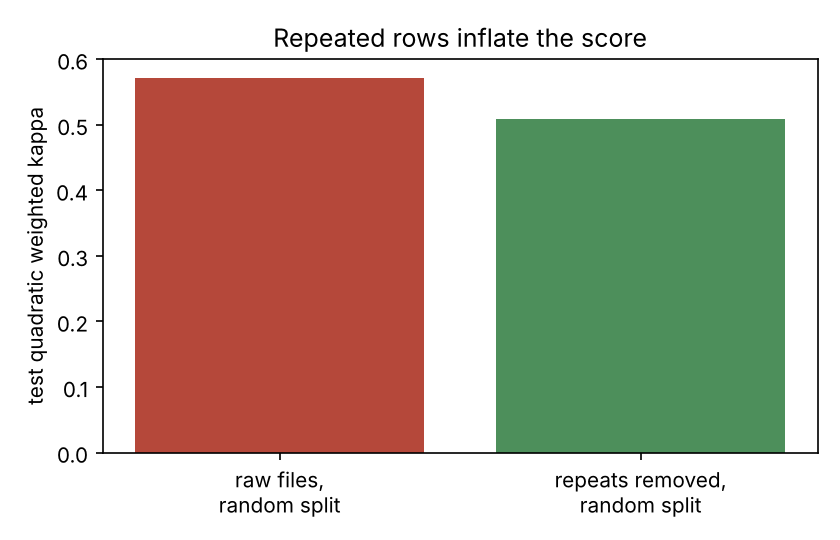
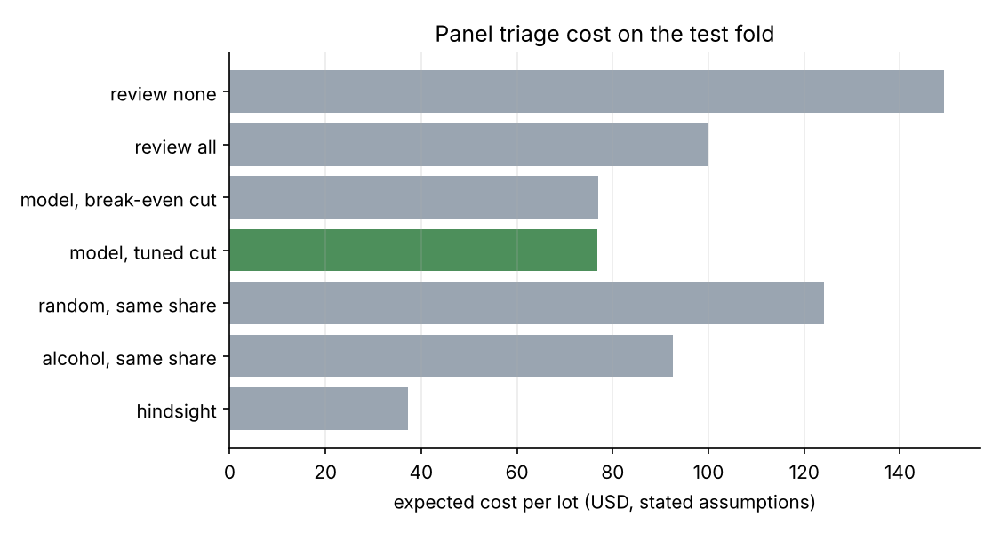
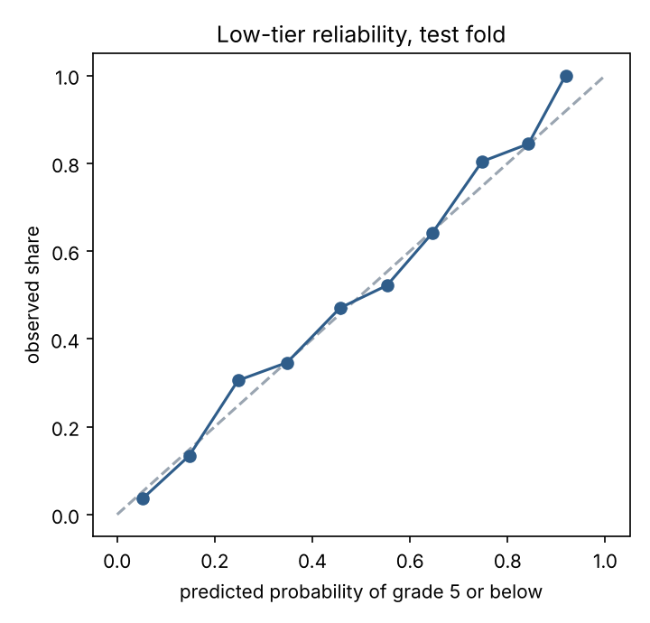

# gradeline

[](https://github.com/ranjithguggilla/gradeline/actions/workflows/ci.yml)

gradeline grades wine lots from lab measurements and decides which lots are worth a tasting panel's time. The panel scores a lot from 3 to 9. That scale is ordered, so a miss by two grades is worse than a miss by one, and most off-the-shelf classifiers ignore that. I built the grader as an ordinal model, scored it with quadratic weighted kappa, and put a cost-based triage rule on top: lots that look safe are released, the rest go to the panel.

The data is the public vinho verde set (red and white, 6,497 rows). 1,177 of those rows are exact repeats of another row, which I removed before splitting. The effect on the score is measured further down.

## Results

Test fold: 1,064 lots the model never saw during selection or fitting. Panel grades are collapsed to five classes (4 or below, 5, 6, 7, 8 or above) because grades 3 and 9 have 30 and 5 lots.

| model | CV kappa | CV MAE | val kappa | test kappa | test MAE | test exact | test within one |
|---|---|---|---|---|---|---|---|
| mode_only | 0.000 ± 0.000 | 0.637 | 0.000 | 0.000 | 0.635 | 0.437 | 0.928 |
| alcohol_cutpoints | 0.447 ± 0.006 | 0.598 | 0.466 | 0.441 | 0.604 | 0.463 | 0.938 |
| ordinal_logit | 0.460 ± 0.006 | 0.506 | 0.482 | 0.495 | 0.492 | 0.546 | 0.963 |
| multinomial_logit | 0.462 ± 0.004 | 0.501 | 0.474 | 0.501 | 0.479 | 0.559 | 0.963 |
| ridge_cutpoints | 0.539 ± 0.007 | 0.567 | 0.521 | 0.553 | 0.549 | 0.505 | 0.951 |
| boosted_multiclass | 0.471 ± 0.007 | 0.506 | 0.478 | 0.536 | 0.465 | 0.572 | 0.962 |
| **boosted_cumulative (shipped)** | 0.504 ± 0.005 | 0.482 | 0.502 | 0.531 | 0.462 | 0.572 | 0.966 |
| boosted_cutpoints | 0.559 ± 0.004 | 0.558 | 0.575 | 0.612 | 0.507 | 0.534 | 0.962 |



The shipped model is not the one with the highest kappa, and I want to be upfront about that. The two "cutpoints" models regress the grade and then search for cutpoints that maximise kappa directly, so they are tuned to the metric they are scored on. They win on kappa (boosted_cutpoints 0.612 on test) but lose on mean absolute error and exact-grade accuracy, and they return a single score rather than a probability for each grade. The triage rule needs probabilities, so the shipping pool is limited to models that produce them. Within that pool the one-standard-error rule on training-fold cross-validation picked boosted_cumulative, the only probabilistic model inside one standard error of the best.

Shipped model on the test fold:

| metric | value |
|---|---|
| quadratic weighted kappa | 0.531 (95% bootstrap CI 0.488 to 0.572) |
| mean absolute grade error | 0.462 (0.430 to 0.497) |
| exact grade | 57.2% |
| within one grade | 96.6% |
| ranked probability score | 0.0814 |
| Krippendorff alpha (ordinal), model vs panel | 0.556 |
| calibration error of P(grade 5 or below) | 0.020 |

Exact accuracy of 57% sounds modest, and it is. The panel itself is noisy and the chemistry explains only part of a taster's score. The mode-only baseline gets 43.7% exact simply because 6 is the most common grade, which is why I lean on kappa and within-one accuracy instead.



### Which differences are real

A Friedman test over the 15 cross-validation folds rejects equal performance (p = 2e-17), and the Nemenyi post-hoc table splits the models into groups. ordinal_logit, multinomial_logit and boosted_multiclass are statistically indistinguishable from each other (p above 0.99 for each pair). boosted_cumulative is not separable from the cutpoint models (p = 0.85 against ridge_cutpoints, 0.42 against boosted_cutpoints) nor from the logistic pair (p = 0.11 and 0.25). On the test fold, shipped versus multinomial logit on exact-grade correctness gives McNemar p = 0.31, so I would not claim the boosted model gets more grades right.

### Decoding the grade from probabilities

For a model that outputs a distribution, the grade you report is a choice. On the shipped model:

| decoding | kappa | MAE | within one |
|---|---|---|---|
| most likely grade | 0.518 | 0.472 | 0.957 |
| median of distribution (shipped) | 0.531 | 0.462 | 0.966 |
| rounded expected grade | 0.540 | 0.451 | 0.971 |

The median is the principled choice for absolute error, and it beat the argmax on all three. Rounding the expectation did slightly better still on this test fold; I kept the median because I chose it before looking at test, and the difference is small.

### Repeated rows and the colour question

18.1% of the raw rows are repeats. A random split of the raw files lets the same lot land in both train and test:



| split | kappa (mean of 5 seeds, boosted multiclass) |
|---|---|
| raw files, random rows | 0.572 |
| repeats removed, random rows | 0.508 |

That is 0.064 of kappa that comes from remembering lots, not grading them.

Red and white were pooled with a colour flag. On a held-out slice (271 red and 793 white lots) a red-only model scored 0.599 on red against 0.556 for the pooled model, and white-only scored 0.512 on white against 0.513 pooled. The red gain comes from 271 lots, so I treat it as a hint, not a finding. A model trained on white wines only and applied to red scores 0.153, which is the real reason colour stays in the feature set.

### Panel triage economics

The data has no dollar values, so these are assumptions you should replace with your own: a panel review costs $100 per lot and catches a low-tier lot (grade 5 or below) with certainty; a low-tier lot that ships unreviewed costs $400 (returns, relabelling, brand damage). The break-even probability is 0.25. The model's cut-off was tuned on validation lots (0.29).



| policy | cost per lot | total on 1,064 lots |
|---|---|---|
| review none | $149.25 | $158,800 |
| review all | $100.00 | $106,400 |
| model, break-even cut 0.25 | $76.97 | $81,900 |
| model, tuned cut 0.29 | $76.79 | $81,700 |
| random review, same share | $124.14 | $132,088 |
| alcohol rank, same share | $92.58 | $98,500 |
| hindsight (review exactly the low-tier lots) | $37.31 | $39,700 |

The tuned rule sends 51.2% of lots to the panel and catches 82.9% of the low-tier ones. Against reviewing everything it saves $23.21 per lot (bootstrap 95% interval $17.76 to $28.67). With a review budget of 20% of lots, the model finds 42.8% of low-tier lots, ranking by alcohol alone finds 33.8%, and random review finds 20%. Roughly 37% of lots are low tier, so there is a lot of bad wine to find and the model only closes part of the gap to hindsight.

The saving depends on the cost ratio. Across review costs from 0.1 to 0.8 of a missed lot's cost (table in `metrics.json`), the model beat both review-all and review-none every time, though at a ratio of 0.8 it is only $1.88 per lot cheaper than reviewing nothing.



Isotonic recalibration of the low-tier probability made things slightly worse (test calibration error 0.030 against 0.020 raw), so the raw probability ships.

What drives the grade, by permutation importance in kappa: alcohol (0.237), volatile acidity (0.084), free sulfur dioxide (0.064), chlorides (0.045), total sulfur dioxide (0.033). Colour, pH and fixed acidity contribute essentially nothing once the rest are known.

## Architecture

```
 winequality-red.csv ─┐
                      ├─> stack + colour flag ─> drop repeats ─> stratified 60/20/20
 winequality-white.csv┘
                                                        │
              ┌─────────────────────────────────────────┤
              v                                         v
   repeated 5-fold CV on train                  fit on train + validation
   8 candidate models, kappa / MAE / RPS                  │
              │                                           v
   one-SE rule inside probabilistic pool          test fold, scored once
              │                                           │
              └──> shipped model ──> grade distribution ──┼─> median decode ─> grade
                                                          └─> P(grade <= 5) ─> triage rule
                                                                                   │
                                          what-if reasons <────────────────────────┘
                                          gradio app, metrics.json, charts
```

## Installation

```bash
git clone https://github.com/ranjithguggilla/gradeline.git
cd gradeline
python -m venv .venv && source .venv/bin/activate
pip install -r requirements.txt
pip install -e . --no-deps
```

Python 3.11 or newer. The pinned versions in `requirements.txt` are the ones the results above were produced with.

## Usage

1. Train, evaluate and write everything (about two minutes on a laptop):

   ```bash
   python -m gradeline.pipeline --out outputs --assets assets
   ```

2. Open the scoring app:

   ```bash
   python -m gradeline.app
   ```

3. Or score a lot from Python:

   ```python
   from gradeline.service import load_bundle, score_lot

   bundle = load_bundle("outputs/gradeline_model.joblib")
   lot = {"fixed_acidity": 7.4, "volatile_acidity": 0.70, "citric_acid": 0.0,
          "residual_sugar": 1.9, "chlorides": 0.076, "free_sulfur_dioxide": 11,
          "total_sulfur_dioxide": 34, "density": 0.9978, "pH": 3.51,
          "sulphates": 0.56, "alcohol": 9.4, "is_red": 1}
   print(score_lot(lot, bundle))
   ```

   The result holds the grade distribution, the most likely grade, the probability of grade 5 or below, the triage call, up to three plain-language reasons, and a list of any measurements outside the training range.

`--quick` runs three cheap models for smoke testing.

## Configuration

| setting | where | default |
|---|---|---|
| split seed, CV repeats | `run()` in `pipeline.py` | 0, 3 |
| review and missed-lot costs | `Costs` in `economics.py` | $100, $400 |
| grade collapse and low-tier boundary | `data.py` | five classes, low tier is grade 5 or below |
| model hyperparameters | `models.py` | boosting: 150 iterations, depth 4, rate 0.06 |

## Output structure

```
outputs/
  metrics.json            every number quoted in this README
  gradeline_model.joblib  shipped model, reference lot, threshold, input ranges
  test_predictions.csv    test lots with predicted class and low-tier probability
assets/                   charts used above
```

## Project structure

```
src/gradeline/
  data.py        loading, de-duplication, grade collapse, split
  ordinal.py     cumulative-binary classifier, cutpoint regressor, decoders
  models.py      candidate registry and preprocessing pipelines
  metrics.py     kappa, ranked probability score, calibration, bootstrap
  economics.py   triage cost model and threshold search
  explain.py     what-if reasons and permutation importance
  pipeline.py    selection, test evaluation, studies, bundle, charts
  plots.py       chart code
  service.py     validation and scoring of one lot
  app.py         gradio interface
tests/           32 tests
data/            the two source csv files
```

## Technical details

- **Cumulative binary model.** One boosted classifier per grade boundary estimates P(grade above k). The cumulative probabilities are forced to be non-increasing and differenced into a proper distribution (Frank and Hall, 2001).
- **Cutpoint models.** A regressor predicts the grade and cutpoints are searched on out-of-fold predictions to maximise quadratic kappa, so the cutpoints are never fitted on scores the regressor has memorised.
- **No leakage.** Log transforms and scaling sit inside the model pipeline. Selection uses training folds only. The test fold is scored once, with models refit on train plus validation.
- **Selection.** Mean cross-validated kappa over 5 folds repeated 3 times; the simplest probabilistic model within one standard error of the best ships.
- **Explanations.** For one lot, each measurement is swapped for the median lot's value and the change in expected grade is reported. It is a what-if reading of the model, not a causal claim about wine chemistry.
- **Limits.** One region, one vintage window, and tasters who disagree. Grades above 8 and below 4 are merged. The dollar figures are assumptions.

## Testing

```bash
ruff check src tests
pytest -q --cov=gradeline
```

32 tests, 84% line coverage. They cover the ordinal decomposition (valid distributions, monotone cumulative probabilities), decoders on hand-built cases, cutpoint recovery, metric arithmetic, cost accounting, the split, input validation in the scorer, and a quick end-to-end run that writes outputs and builds the app.

## Dataset

Cortez, P., Cerdeira, A., Almeida, F., Matos, T. and Reis, J. (2009), Modeling wine preferences by data mining from physicochemical properties, Decision Support Systems 47(4). Copies of the two csv files come from https://github.com/shrikant-temburwar/Wine-Quality-Dataset (originally the UCI Wine Quality dataset).

## License

MIT, see `LICENSE`.
